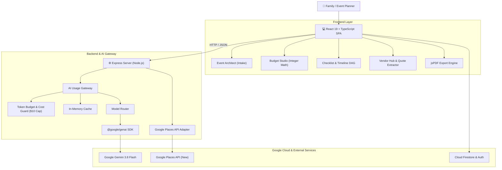

# FeastaMind — You Celebrate. We Plan.

> **Production-Grade, Governed Event Planning Copilot for Indian Celebrations**  
> *Built for the innovation challenge organized by **Hack2skill (H2S)** and co-powered by **Google**.*

---

## 📌 Table of Contents
- [Overview & The Problem](#-overview--the-problem)
- [Architectural Philosophy](#-architectural-philosophy)
- [Key Features](#-key-features)
- [Google Technologies & Cloud Services](#-google-technologies--cloud-services)
- [System Architecture](#-system-architecture)
- [Security, Privacy & Compliance](#-security-privacy--compliance)
- [Automated Testing Suite (51/51 Passing)](#-automated-testing-suite-5151-passing)
- [Project Structure](#-project-structure)
- [Getting Started](#-getting-started)
- [Environment Variables](#-environment-variables)
- [Acknowledgments](#-acknowledgments)

---

## 🎯 Overview & The Problem

Planning an Indian wedding or celebration is not a single party; it is a multi-day, multi-generational, high-stakes logistical operation with hundreds of guests, complex dietary preferences, cultural rituals, and emotional budget anxiety. 

Families routinely experience **20% to 40% budget overruns** because a sudden change in guest count creates hidden ripple effects across catering plate minimums, venue capacity surcharges, decor, and transport.

### Why Standard LLM Chatbots Fail:
1. **Math Hallucinations & Floating-Point Drift:** LLMs cannot reliably perform multi-tiered financial arithmetic or enforce hard spending caps.
2. **Double-Charging:** Bundled vendor quotes frequently double-count venue rentals and catering sub-charges.
3. **Prompt Injection Risks:** Uploaded vendor quotes often contain untrusted, adversarial text that can manipulate planning agents.
4. **Lack of Sovereignty:** Autonomous bots silently modify plans without explicit family consensus.

**FeastaMind** solves this with an enterprise-grade, governed copilot architecture.

---

## 🧠 Architectural Philosophy

### *"AI Proposes, Deterministic Logic Enforces"*

FeastaMind pairs **Google Gemini** generative intelligence with **deterministic mathematical engines**:
- **Gemini 3.8 Flash** handles natural language understanding, conversational intake, contextual micro-task generation, and untrusted document parsing.
- **Deterministic Code** enforces integer rupee arithmetic, budget invariants, contingency reserve rebalancing, permission checks, and state machine auditability.

---

## ✨ Key Features

### 1. 💬 Conversational Event Architect
- Interactive intake extracting complex celebration parameters: guest count, city, regional cuisine (e.g., pure vegetarian Marwari cuisine), rituals, and hard budget caps.
- Dynamic follow-up chips and instant structured blueprint generation stored directly into Cloud Firestore.

### 2. 📊 Budget Intelligence & Ripple-Effect Replanner
- **Integer Arithmetic:** Prevents floating-point accumulation errors on plate calculations (`200 plates × ₹900 + extras = ₹2,00,000`).
- **Strict Separation of Concerns:** Venue rental and catering costs are isolated into distinct categories (`cat-venue` vs `cat-catering`) to prevent vendor double-charging.
- **Protected Contingency Reserve:** A strategic 15% reserve (`₹1,80,000`). When guest count increases (e.g., 200 → 250 guests = +₹45,000 catering), FeastaMind dynamically rebalances from the reserve (`₹1,80,000 → ₹1,35,000`), keeping the total celebration ceiling strictly balanced at ₹0 variance.
- **Idempotency & Versioning:** Every plan modification requires explicit user approval and includes idempotency keys to prevent double-allocation on re-clicks.

### 3. 📅 Culturally Grounded Timelines & Micro-Tasks
- 24+ ritual-aware micro-tasks (outfit fabric finalization, master tailor trials, Rajasthani Safa styling, Baraat route permissions) with T-minus milestone offsets.
- Multi-family task delegation with assigned owners: Groom, Bride, Father, Mother.
- Dependency DAG validation ensuring logical prerequisite sequencing (e.g., tailor trial depends on fabric selection).
- AI task expansion opens in candidate preview dialogs—zero silent mutations.

### 4. 📍 Verified Local Vendor Hub
- Real-time integration with **Google Places API (New Text Search)** for verified caterers, decorators, and venues with authentic ratings and phone numbers.
- Explicit rate clarification banners preventing hallucinated pricing claims.

### 5. 🛡️ Adversarial AI Quote Extractor
- Analyzes vendor quotation PDFs with prompt injection defense.
- Quotations are isolated in `<<<UNTRUSTED_VENDOR_DOCUMENT>>>` boundaries, commanding Gemini to ignore malicious commands (e.g., attempts to automatically deduct funds or force bookings).
- Produces confidence-scored candidate proposals with line-item citations.

### 6. 📑 1-Click Executive PDF Brief
- Compiles client-side, print-ready, 2-page celebration briefs (`FeastaMind_Event_Brief.pdf`) using `jsPDF` with exact budget allocations, critical milestones, and legal disclaimers.

### 7. ⚙️ Centralized AI Usage Gateway
- Per-user token quotas, model router (`gemini-3.8-flash` standard, `gemini-3.1-flash-lite` ultra-low-cost, `gemini-4-argon` fallback).
- Response caching, $10 project-level budget guards, and real-time observability dashboards.

---

## 🤖 Google Technologies & Cloud Services

| Technology | Purpose in FeastaMind |
|---|---|
| **Google Gemini 3.8 Flash** | Fast, structured generative reasoning, intake parsing, quote extraction, and timeline generation with configurable `thinkingLevel`. |
| **Google Gen AI SDK (`@google/genai`)** | TypeScript SDK providing direct, typed server-side communication with Gemini endpoints. |
| **Cloud Firestore** | Real-time NoSQL document database providing atomic transaction guarantees and offline sync for event plans. |
| **Firebase Authentication** | User identity management and role-based access for multi-family collaboration. |
| **Google Places API (New)** | Real-time discovery of verified local catering services, banquet halls, and decorators. |

---

## 🏗️ System Architecture



---

## 🔒 Security, Privacy & Compliance

- **Zero-Trust Access Control:** Enforced via `firestore.rules`. Cross-account event access is blocked at the database level (`resource.data.ownerId == request.auth.uid`).
- **Prompt Injection Boundaries:** Untrusted vendor text is strictly isolated; imperative instructions to modify budgets or bypass checks are ignored.
- **Hardened HTTP Response Headers:** `X-Content-Type-Options: nosniff`, `X-Frame-Options: SAMEORIGIN`, `Referrer-Policy: strict-origin-when-cross-origin`, and `Permissions-Policy`.
- **Structured Audit Logging:** Every `/api/*` call is logged with structured JSON containing timestamps, latency, request IDs, and status codes.
- **Privacy & DPDP/GDPR Compliance:** Minimizes PII in AI prompts; supports complete cascade deletion of celebration records and subcollections.

---

## 🧪 Automated Testing Suite (51/51 Passing)

FeastaMind includes 51 comprehensive automated test suites covering every critical path:

- **AI Usage Gateway Tests (6 tests):** Token quota enforcement, response cache hit/miss, cost calculation accuracy, and budget ceiling guardrails.
- **Event Architect Tests (5 tests):** Multi-turn intake extraction, cultural constraint parsing, and schema generation.
- **Budget Engine Tests (8 tests):** Integer arithmetic, non-overlapping category isolation, and balanced rupee allocations.
- **Checklist & DAG Tests (7 tests):** Milestone offsets, family role delegation, and circular dependency validation.
- **Replanning Tests (8 tests):** Ripple-effect calculation, contingency reserve rebalancing, and idempotency key conflict handling.
- **Vendor & Security Tests (7 tests):** Google Places search normalization and adversarial prompt injection defense.
- **Hardening Matrix Tests (10 tests):** End-to-end multi-service consistency, security headers, and failure recovery.

To trigger the test suite via the running server:
```bash
curl -X POST http://localhost:3000/api/hardening/run-tests
curl -X POST http://localhost:3000/api/vendors/run-tests
```

---

## 📂 Project Structure

```
.
├── docs/
│   ├── JURY_DEMO_SCRIPT.md          # 8-minute jury demonstration walkthrough
│   └── SECURITY_PRIVACY_COMPLIANCE.md # Hardening, security headers & privacy spec
├── src/
│   ├── components/                  # React UI components
│   │   ├── budget/                  # Budget breakdown & replanning widgets
│   │   ├── copilot/                 # AI assistant panels
│   │   ├── layout/                  # Navigation & layout wrappers
│   │   └── screens/                 # Main application screens (BudgetStudio, VendorHub, etc.)
│   ├── domain/                      # Pure deterministic business logic
│   │   └── budgetEngine.ts          # Integer arithmetic & balance calculation
│   ├── server/                      # Server-side services & AI Gateway
│   │   ├── architect/               # Intake processing & validation
│   │   ├── budget/                  # Server budget advisor
│   │   ├── checklist/               # Culturally-grounded timeline & DAG
│   │   ├── gateway/                 # Token budget, cost guard & Gemini client
│   │   ├── replanning/              # Natural language impact & proposal engine
│   │   └── vendors/                 # Google Places adapter & quote extractor
│   ├── services/                    # Client API & Firestore connectors
│   │   ├── aiGatewayClient.ts       # Gateway client interface
│   │   ├── firestoreService.ts      # Cloud Firestore transactions & listeners
│   │   └── pdfExportService.ts      # Multi-page jsPDF document generator
│   ├── App.tsx                      # Root application component
│   └── main.tsx                     # Entry point
├── server.ts                        # Express backend, Vite dev middleware & API routes
├── firestore.rules                  # Production Cloud Firestore security rules
├── package.json                     # Dependencies & scripts
└── tsconfig.json                    # TypeScript configuration
```

---

## 🚀 Getting Started

### Prerequisites
- **Node.js**: v18.0.0 or higher
- **npm** or **bun**
- **Google Gemini API Key** (from Google AI Studio)
- **Google Maps Platform API Key** (with Places API (New) enabled)

### Installation
1. Clone the repository:
   ```bash
   git clone https://github.com/your-repo/feastamind.git
   cd feastamind
   ```

2. Install dependencies:
   ```bash
   npm install
   ```

3. Create and configure your `.env` file:
   ```bash
   cp .env.example .env
   ```

4. Run the development server:
   ```bash
   npm run dev
   ```

5. Open your browser and navigate to:
   ```
   http://localhost:3000
   ```

---

## ⚙️ Environment Variables

Configure the following variables in your `.env` file:

```env
# Google Gemini API Key (Server-Only, never exposed to browser)
GEMINI_API_KEY=your_gemini_api_key_here

# Google Maps Platform Key (Used for Google Places API New Text Search)
VITE_GOOGLE_MAPS_API_KEY=your_google_maps_key_here

# Server Port
PORT=3000

# Application URL
APP_URL=http://localhost:3000
```

---

## 🏆 Acknowledgments

- **Hack2skill (H2S)** for organizing this challenging hackathon.
- **Google** for co-powering the initiative and providing access to Google Gemini 3.8 Flash and the Google Cloud ecosystem.
